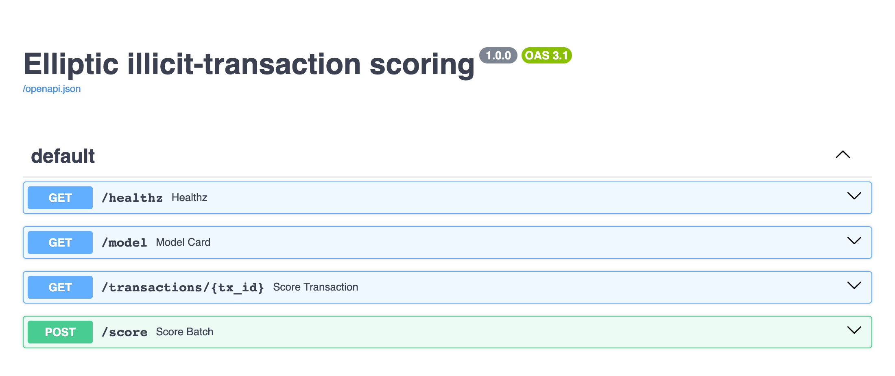
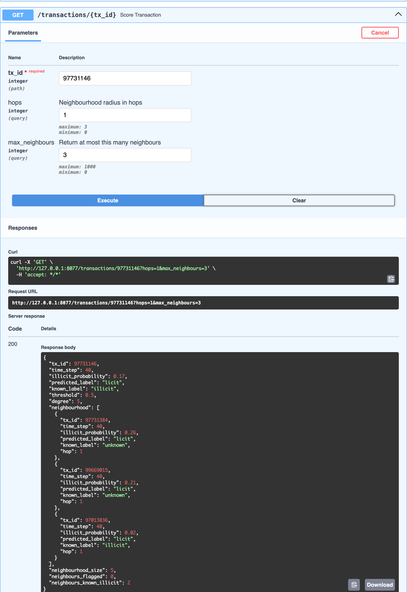
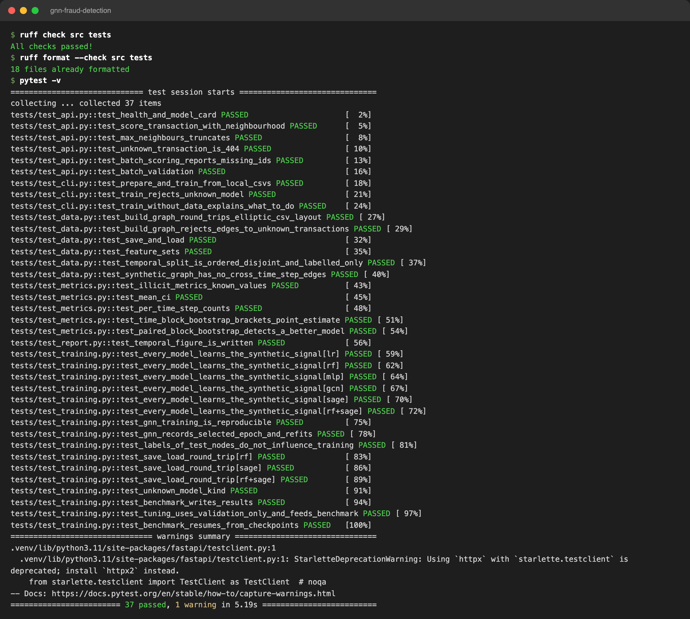
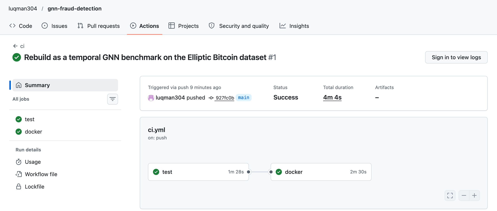
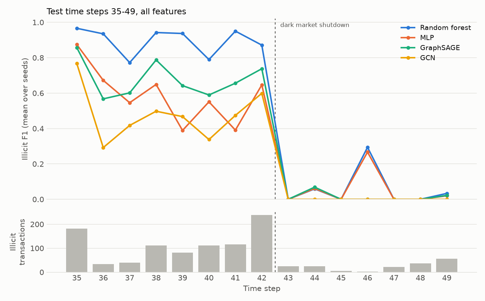

# Illicit Bitcoin Transaction Detection with Graph Neural Networks

**A temporal benchmark of feature baselines and graph neural networks on the Elliptic Bitcoin dataset, with a
scoring API that explains a prediction through the transaction's neighbourhood.**

Can the structure of the Bitcoin transaction graph help identify illicit transactions (scams, ransomware, dark
markets), beyond what each transaction's own features already say? This project answers that question on the
public [Elliptic dataset](https://www.kaggle.com/datasets/ellipticco/elliptic-data-set) (203,769 transactions,
234,355 payment flows, 49 time steps) using a protocol that never lets a model see the future: models are
trained on the first 34 time steps and tested on the last 15, as in the original paper by
[Weber et al. (2019)](https://arxiv.org/abs/1908.02591).

Six models are compared over 5 random seeds each, on two feature sets, with confidence intervals:
logistic regression, random forest, an MLP, GCN, GraphSAGE, and a random forest on features plus GraphSAGE
node embeddings. The best model is served by a FastAPI service that returns the illicit probability for a
transaction id together with the scores and known labels of its 1 to 3-hop neighbourhood.

`Python 3.11+` · `PyTorch` · `PyTorch Geometric` · `scikit-learn` · `FastAPI` · `Typer` · `Docker Compose` ·
`pytest` · `ruff` · `GitHub Actions`

---

## Demo

The screenshots below were taken from the running service on the full Elliptic graph and from the test suite.

**Interactive API docs** (`gnnfraud serve`, then http://127.0.0.1:8000/docs).



**Scoring a transaction and its neighbourhood.** This is a known illicit transaction that the model misses
(probability 0.17). The neighbourhood view shows that two of its five neighbours are known illicit, which is the
context an analyst would use to catch it.



**Lint and tests passing locally** (37 tests, offline, about 5 seconds).



**The same checks and the Docker build passing in GitHub Actions.**



---

## Contents

1. [Demo](#demo)
2. [Headline results](#headline-results)
3. [Dataset](#dataset)
4. [Evaluation protocol](#evaluation-protocol)
5. [Models](#models)
6. [Full results](#full-results)
7. [Findings](#findings)
8. [Quick start](#quick-start)
9. [Scoring API](#scoring-api)
10. [Reproducing the results](#reproducing-the-results)
11. [Testing and CI](#testing-and-ci)
12. [Project layout](#project-layout)
13. [Limitations](#limitations)
14. [References](#references)

---

## Headline results

Illicit class, test time steps 35-49, threshold 0.5, mean ± 95% CI half-width over 5 seeds.

| Model | Features | Precision | Recall | **F1** | PR-AUC | F1, steps 35-42 | F1, steps 43-49 | Weber et al. F1 |
|---|---|---|---|---|---|---|---|---|
| Random forest | all | 0.932 ± 0.015 | 0.724 ± 0.001 | **0.815 ± 0.006** | 0.784 ± 0.003 | 0.906 | 0.030 | 0.788 |
| Random forest | local | 0.853 ± 0.016 | 0.705 ± 0.007 | **0.772 ± 0.008** | 0.773 ± 0.001 | 0.868 | 0.027 | 0.694 |
| MLP (no graph) | local | 0.883 ± 0.021 | 0.678 ± 0.012 | **0.767 ± 0.008** | 0.704 ± 0.016 | 0.857 | 0.021 | 0.649 |
| GraphSAGE | local | 0.739 ± 0.067 | 0.612 ± 0.036 | **0.668 ± 0.014** | 0.688 ± 0.015 | 0.781 | 0.025 | – |
| GraphSAGE | all | 0.790 ± 0.063 | 0.536 ± 0.089 | **0.637 ± 0.078** | 0.622 ± 0.062 | 0.721 | 0.016 | – |
| GCN | all | 0.905 ± 0.027 | 0.336 ± 0.056 | **0.489 ± 0.055** | 0.657 ± 0.010 | 0.557 | 0.000 | 0.628 |
| Logistic regression | all | 0.292 | 0.651 | **0.403** | 0.359 | 0.545 | 0.048 | 0.481 |

The last column is from Table 1 of the paper, which uses the same 34/15 split. Its "local" set also includes
the time step and its random forest has 50 trees, so the local-feature rows are not strictly comparable. Every
configuration, including logistic regression and the RF + embeddings variant, is in [Full results](#full-results).

**In short:**

1. **A random forest on the transaction features is the best model** (F1 0.815, PR-AUC 0.784). It is better
   than the best graph model (GraphSAGE on local features, 0.668) by 0.15 F1, and than GraphSAGE on the same
   features by 0.18 (paired 95% bootstrap interval [+0.136, +0.238]). This reproduces, and slightly improves
   on, the main result of the original paper.
2. **Message passing did not beat a graph-free network trained the same way.** On the 93 local features, an MLP
   with the same architecture, optimiser and early stopping as the GNNs scores 0.767. GraphSAGE scores 0.668 and
   GCN 0.093. With all features GraphSAGE does beat the MLP, but only because the MLP degrades on that set.
3. **Every model fails after the dark-market shutdown at time step 43.** The best model's F1 falls from 0.906 to
   0.030. New illicit behaviour after a market event is out of distribution for all of them, graph or not.



---

## Dataset

| | |
|---|---|
| Nodes (transactions) | 203,769 |
| Edges (directed payment flows) | 234,355 |
| Time steps | 49, roughly two weeks each |
| Features per node | 165 anonymised: 93 *local* (the transaction itself) + 72 *aggregated* (one-hop neighbourhood statistics) |
| Labels | 4,545 illicit (2.2%), 42,019 licit (20.6%), 157,205 unknown (77.1%) |
| Edges between different time steps | 0 (the graphs of different time steps are disconnected) |

The data is downloaded by `gnnfraud prepare` from the PyTorch Geometric mirror of the Kaggle release and is
not redistributed in this repository. Elliptic's terms of use apply to the data.

Two feature sets are evaluated, following the paper: **local** (the 93 transaction features) and **all** (local
plus the 72 hand-crafted neighbourhood aggregates). The aggregated features already encode one hop of graph
information, so the *local* setting is the cleaner test of what message passing can learn by itself.

---

## Evaluation protocol

The protocol is designed so that no number in this README depends on information from the test period.

- **Temporal split.** Time steps 1-29 are used for training, 30-34 for validation (early stopping and
  hyperparameter selection) and 35-49 for testing. A random node split would leak: transactions in the same
  time step share actors and market conditions, and the illicit rate varies strongly over time.
- **Labelled nodes only.** Losses and metrics use labelled nodes only. Unlabelled nodes still take part in
  message passing as graph context.
- **Same training data for every model.** Feature baselines are fit on labelled nodes of steps 1-34. Neural
  models are trained on 1-29 with early stopping on validation PR-AUC, then retrained from scratch on 1-34 for
  the number of epochs selected. Feature standardisation is fit only on the training period.
- **Hyperparameters chosen on validation only.** `gnnfraud tune` grid-searches learning rate
  {0.01, 0.003} × illicit class weight {0.5, 0.7} for each neural model using validation PR-AUC
  ([results/tuning.csv](results/tuning.csv)). The search uses all features and seed 0; the selected settings
  (class weight 0.5 for all three, learning rate 0.01 for MLP and GraphSAGE, 0.003 for GCN) are then used for
  both feature sets. Random forest uses the paper's setting (`max_features=50`)
  with 100 trees. Nothing was tuned on the test steps.
- **Fixed decision threshold.** Precision, recall and F1 are reported for the illicit class at a 0.5
  probability threshold, as in the paper. PR-AUC is reported alongside as a threshold-free measure, which
  matters here because probability calibration shifts over time.
- **Uncertainty.** Every stochastic model is run with 5 seeds (0-4). Tables report mean ± the half-width of a
  95% Student-t interval over seeds (training variance). A second interval resamples whole test time steps
  (1,000 block-bootstrap resamples, seed 0) to show how much the score depends on which periods are in the test
  set. Logistic regression is deterministic and is run once. Claims that one model beats another rest on
  paired bootstrap comparisons: both models are scored on the same resampled time steps, which removes the
  shared period effect ([results/comparisons.csv](results/comparisons.csv)).
- **Isolation.** A test flips every test label and checks that predictions do not change
  ([tests/test_training.py](tests/test_training.py)).

---

## Models

| Name | Description |
|---|---|
| `lr` | Standardised features → logistic regression |
| `rf` | Random forest, 100 trees, `max_features=50` |
| `mlp` | Two hidden layers (128, ReLU, dropout 0.3); same architecture and training loop as the GNNs, without the graph |
| `gcn` | Two `GCNConv` layers (Kipf & Welling) on the undirected graph, linear head |
| `sage` | Two `SAGEConv` layers with mean aggregation (Hamilton et al.), linear head |
| `rf+sage` | Random forest on node features concatenated with the 128-d GraphSAGE embeddings |

Neural models are trained full-batch with Adam (weight decay 5e-4), weighted cross-entropy, up to 200 epochs
and patience 30. The MLP is the control for the GNNs: any gain of `gcn` or `sage` over `mlp` comes from the
graph, not from the training setup.

---

## Full results

Illicit class, test time steps 35-49 (16,670 labelled transactions, 1,083 illicit). Mean ± 95% CI half-width over
5 seeds. The bootstrap column resamples test time steps.

| Features | Model | Precision | Recall | F1 | PR-AUC | ROC-AUC | F1 95% CI (time-step bootstrap) | F1 before step 43 | F1 from step 43 |
|---|---|---|---|---|---|---|---|---|---|
| local | lr | 0.379 | 0.711 | **0.494** | 0.277 | 0.865 | [0.288, 0.633] | 0.646 | 0.021 |
| local | rf | 0.853 ± 0.016 | 0.705 ± 0.007 | **0.772 ± 0.008** | 0.773 ± 0.001 | 0.895 ± 0.003 | [0.585, 0.856] | 0.868 ± 0.008 | 0.027 ± 0.001 |
| local | mlp | 0.883 ± 0.021 | 0.678 ± 0.012 | **0.767 ± 0.008** | 0.704 ± 0.016 | 0.897 ± 0.007 | [0.587, 0.847] | 0.857 ± 0.007 | 0.021 ± 0.005 |
| local | gcn | 0.432 ± 0.533 | 0.054 ± 0.070 | **0.093 ± 0.117** | 0.378 ± 0.034 | 0.838 ± 0.003 | [0.009, 0.147] | 0.110 ± 0.139 | 0.000 |
| local | sage | 0.739 ± 0.067 | 0.612 ± 0.036 | **0.668 ± 0.014** | 0.688 ± 0.015 | 0.903 ± 0.005 | [0.405, 0.761] | 0.781 ± 0.010 | 0.025 ± 0.011 |
| local | rf+sage | 0.650 ± 0.032 | 0.628 ± 0.030 | **0.639 ± 0.030** | 0.677 ± 0.044 | 0.878 ± 0.022 | [0.349, 0.728] | 0.769 ± 0.026 | 0.034 ± 0.013 |
| all | lr | 0.292 | 0.651 | **0.403** | 0.359 | 0.891 | [0.221, 0.542] | 0.545 | 0.048 |
| all | rf | 0.932 ± 0.015 | 0.724 ± 0.001 | **0.815 ± 0.006** | 0.784 ± 0.003 | 0.913 ± 0.005 | [0.631, 0.889] | 0.906 ± 0.003 | 0.030 ± 0.001 |
| all | mlp | 0.812 ± 0.155 | 0.433 ± 0.071 | **0.563 ± 0.088** | 0.588 ± 0.076 | 0.900 ± 0.009 | [0.392, 0.721] | 0.637 ± 0.098 | 0.020 ± 0.009 |
| all | gcn | 0.905 ± 0.027 | 0.336 ± 0.056 | **0.489 ± 0.055** | 0.657 ± 0.010 | 0.892 ± 0.002 | [0.256, 0.598] | 0.557 ± 0.063 | 0.000 |
| all | sage | 0.790 ± 0.063 | 0.536 ± 0.089 | **0.637 ± 0.078** | 0.622 ± 0.062 | 0.900 ± 0.014 | [0.435, 0.725] | 0.721 ± 0.081 | 0.016 ± 0.005 |
| all | rf+sage | 0.838 ± 0.058 | 0.525 ± 0.064 | **0.645 ± 0.061** | 0.639 ± 0.043 | 0.834 ± 0.020 | [0.417, 0.707] | 0.724 ± 0.068 | 0.020 ± 0.001 |

The same figure for local features is [results/temporal_f1_local.png](results/temporal_f1_local.png).
Raw per-run numbers are in [results/runs.csv](results/runs.csv), per-time-step scores in
[results/per_time_step.csv](results/per_time_step.csv), and the exact configuration and library versions in
[results/config.json](results/config.json).

---

## Findings

Paired comparisons. Both models are scored on the same 1,000 resamples of the 15 test time steps, so
period-to-period variation cancels; the last column reads like a one-sided p-value.

| A (model/features) | B | F1 difference A - B | 95% CI (paired time-step bootstrap) | Share of resamples with A ≤ B |
|---|---|---|---|---|
| rf/all | rf/local | +0.043 | [+0.031, +0.058] | 0.000 |
| rf/all | sage/all | +0.178 | [+0.136, +0.238] | 0.000 |
| rf/all | rf+sage/all | +0.170 | [+0.117, +0.255] | 0.000 |
| rf/local | rf+sage/local | +0.133 | [+0.072, +0.224] | 0.000 |
| mlp/local | sage/local | +0.099 | [+0.051, +0.178] | 0.000 |
| sage/local | gcn/local | +0.575 | [+0.394, +0.650] | 0.000 |
| sage/all | mlp/all | +0.074 | [+0.011, +0.146] | 0.010 |
| mlp/local | mlp/all | +0.204 | [+0.111, +0.326] | 0.000 |

**1. The engineered features carry most of the signal, and tree ensembles use them best.** The random forest is
the best model on both feature sets. Adding the 72 aggregated neighbourhood features helps it by +0.043 F1
(paired CI [+0.031, +0.058]). It is also the most stable model: its F1 varies by less than ±0.01 across seeds.

**2. GraphSAGE is worse than its graph-free control on local features (-0.099 F1, CI [-0.178, -0.051]).** In
validation (steps 30-34, all features) GraphSAGE was the strongest neural model (PR-AUC 0.956 against 0.919 for the MLP,
[results/tuning.csv](results/tuning.csv)). On the test period it falls behind. A plausible reading is that
neighbourhood patterns learned in the early time steps drift more than per-transaction patterns do, so a model
that relies on them generalises worse forward in time. Validation scores taken from adjacent time steps
overstate how well graph models transfer.

**3. GCN fails on this task, and the architecture explains why.** `GCNConv` replaces a node's representation
with a degree-normalised average over itself and its neighbours, with no separate weight for the node's own
features. In Elliptic most of the signal is in the node's own features. Only 22% of an illicit transaction's
neighbours are labelled illicit, 18% are licit and 60% are unlabelled, so averaging dilutes the signal. The graph
is homophilous among labelled nodes: 54% of the labelled neighbours of illicit nodes are illicit, against 2.5%
for licit nodes. The structure is informative, but not in a form that plain neighbourhood averaging can
exploit. On local features GCN ranks poorly (PR-AUC 0.378) and almost never crosses the 0.5 threshold (recall 0.054). GraphSAGE keeps a separate root weight for
the node itself and does far better (+0.575 F1 over GCN). The original paper made the same observation: a
skip connection from the input features lifted GCN from 0.628 to 0.705 F1. With the aggregated features
supplied explicitly, GCN recovers to 0.489.

**4. Aggregated features help the forest but hurt the neural models.** The MLP drops from 0.767 to 0.563
(-0.204, CI [-0.326, -0.111]) when the aggregates are added, and its seed-to-seed variance grows sharply
(± 0.088). A likely explanation, which I have not tested directly: the aggregates drift over time, the
forest's threshold splits tolerate that drift, and gradient-trained models fit the aggregates more tightly, so
the fit transfers poorly. With all features GraphSAGE does
beat the MLP (+0.074, CI [+0.011, +0.146]), but only because the MLP degrades. Neither approaches the
forest.

**5. GNN embeddings did not help the forest.** Concatenating GraphSAGE embeddings to the features lowers F1
by 0.170 (all) and 0.133 (local). The most likely cause is that the embeddings come from a network trained on the
same labelled nodes. On training nodes they therefore encode the label far better than they do on test nodes,
so the forest learns to trust a feature that is much weaker at test time. The original paper reports a small gain from GCN
embeddings (0.788 → 0.796). Producing the training embeddings out-of-fold, so they never see their own label,
would be the fair way to test this idea and is left as future work.

**6. The dark-market shutdown breaks every model.** From time step 43 onwards the share of illicit transactions
among labelled ones falls from 9.2% (steps 35-42) to 2.5%. The paper attributes the collapse to illicit activity that differs from what
came before. All twelve configurations score F1 ≤ 0.05 on steps 43-49. The spike at step 46
in the figure comes from 2 illicit transactions among 712 labelled ones. The overall test F1 is therefore an average of
two regimes. Before the shutdown, the random forest reaches 0.906 F1. After it, no model is useful, and
retraining or drift detection would be needed.

**7. The test set is small in the dimension that matters.** It covers 15 time steps, and nodes within a step
are correlated. The bootstrap intervals over time steps are wide (for example [0.631, 0.889] for the best
model), much wider than the seed intervals. Differences of a few points between models should not be read
into. The paired comparisons above are the reliable evidence.

---

## Quick start

```bash
git clone https://github.com/luqman304/gnn-fraud-detection.git
cd gnn-fraud-detection
python -m venv .venv && source .venv/bin/activate
pip install -e ".[dev]"

gnnfraud prepare                                  # download (~700 MB of CSV) and build data/processed/elliptic.npz
gnnfraud train --model rf --features all          # best model, ~20 s; writes artifacts/rf-all
gnnfraud serve                                    # http://127.0.0.1:8000/docs

# any other model can be trained and served, e.g. the GraphSAGE network
gnnfraud train --model sage --features all --device auto
gnnfraud serve --artifact artifacts/sage-all
```

With Docker (data and models are mounted from the host, not baked into the image):

```bash
docker compose --profile jobs run --rm prepare
docker compose --profile jobs run --rm train
docker compose up api
```

`MODEL=sage-all docker compose up api` serves a different artifact.

---

## Scoring API

At start-up the service loads the graph and the model and scores all 203,769 transactions in one pass; requests
are then answered from memory.

| Method | Path | Description |
|---|---|---|
| `GET` | `/transactions/{tx_id}?hops=1&max_neighbours=50` | Score of one transaction plus its neighbourhood (up to 3 hops) |
| `POST` | `/score` | Batch scores for up to 1,000 transaction ids; unknown ids are listed in `missing` |
| `GET` | `/model` | Model type, feature set, threshold, training metadata and test metrics |
| `GET` | `/healthz` | Liveness / readiness |

Example: a known illicit transaction that the model misses. The neighbourhood view is what an analyst would
use to catch it, because two of its five neighbours are known illicit:

```bash
curl "localhost:8000/transactions/97731146?hops=1&max_neighbours=3"
```

```json
{
  "tx_id": 97731146,
  "time_step": 40,
  "illicit_probability": 0.17,
  "predicted_label": "licit",
  "known_label": "illicit",
  "threshold": 0.5,
  "degree": 5,
  "neighbourhood": [
    {"tx_id": 97731384, "time_step": 40, "illicit_probability": 0.26, "predicted_label": "licit", "known_label": "unknown", "hop": 1},
    {"tx_id": 99669015, "time_step": 40, "illicit_probability": 0.21, "predicted_label": "licit", "known_label": "unknown", "hop": 1},
    {"tx_id": 97013836, "time_step": 40, "illicit_probability": 0.02, "predicted_label": "licit", "known_label": "illicit", "hop": 1}
  ],
  "neighbourhood_size": 5,
  "neighbours_flagged": 0,
  "neighbours_known_illicit": 2
}
```

Measured locally on the full graph, a 2-hop request takes about 2 ms. `known_label` exposes the dataset's
ground truth, which is useful for analysis on this public benchmark but would be removed in a real deployment.

---

## Reproducing the results

```bash
gnnfraud prepare
gnnfraud tune --device auto          # validation-only grid search → results/gnn_hparams.json
gnnfraud eval --seeds 5 --device auto  # all models × feature sets × seeds → results/
```

`eval` checkpoints every run under `results/runs/` and resumes after an interruption. `--device auto` uses CUDA
or Apple MPS when available; all results above were produced on an Apple M4 (MPS for neural models, CPU for
scikit-learn). Library versions are recorded in [results/config.json](results/config.json).

CLI summary:

| Command | Purpose |
|---|---|
| `gnnfraud prepare` | Download the CSV files and build the processed graph |
| `gnnfraud tune` | Validation-only hyperparameter search for `mlp`, `gcn`, `sage` |
| `gnnfraud eval` | Full benchmark, tables and figure |
| `gnnfraud train` | Train one model on steps 1-34 and save it for serving |
| `gnnfraud serve` | Start the API |

---

## Testing and CI

```bash
ruff check src tests && ruff format --check src tests
pytest
```

The test suite runs offline in a few seconds on a small synthetic graph with the same file layout as Elliptic
(12 time steps, 960 nodes, homophilous illicit clusters). It covers CSV parsing and validation, split ordering
and label masking, test-label isolation, reproducibility, save/load round trips for every model type,
validation-only tuning, checkpoint resume, the CLI and every API endpoint. GitHub Actions runs lint and tests
on CPU-only PyTorch, then builds the Docker image.

---

## Project layout

```
src/gnn_fraud/
  data.py         download, CSV parsing, TxGraph container, temporal split
  models.py       MLP / GCN / GraphSAGE node classifier
  training.py     training protocol, early stopping and refit, model persistence
  metrics.py      illicit-class metrics, t-intervals, time-step block bootstrap
  experiment.py   benchmark runner, tuning, results tables
  report.py       per-time-step figure
  api.py          FastAPI scoring service
  cli.py          Typer CLI
  synthetic.py    synthetic graphs for tests
tests/            pytest suite (offline)
results/          committed benchmark outputs
```

---

## Limitations

- **One dataset, anonymised features.** Elliptic's features are anonymised, so it is impossible to explain
  *why* a transaction looks illicit or to engineer better features. The conclusions are about this graph and
  this label distribution, not about GNNs for fraud in general.
- **Label noise and selection.** Labels come from Elliptic's heuristics and only 23% of nodes have one. The
  unlabelled majority is probably not a random sample.
- **Snapshot scoring, not streaming.** The API scores a fixed historical graph. A real system would score new
  transactions as they arrive, recompute neighbourhoods incrementally and retrain on a schedule. Retraining is
  exactly what step 43 shows to be necessary.
- **Fixed 0.5 threshold.** This follows the paper and keeps models comparable, but calibration drifts over
  time. An operational system would choose a threshold for a target alert volume and monitor it.
- **Modest tuning budget.** Neural models had a 4-point grid (learning rate × class weight) on one seed, with
  two layers and 128 hidden units fixed. A larger search, deeper models or attention (GAT) could change the
  ranking among GNNs. It is less likely to close a 0.15-0.18 F1 gap to the forest.
- **No temporal GNN.** EvolveGCN-style models, which the paper reports at 0.720 F1, were out of scope.
- **Reproducibility on Apple MPS.** Neural models were trained on MPS, whose kernels are not bit-for-bit
  deterministic. Re-running a seed gives slightly different numbers (within the reported intervals). CPU
  training is deterministic and is what the test suite checks.
- **Docker image built in CI only.** The image is built by GitHub Actions (see the screenshot above); the
  full compose workflow was not run on the development machine.
- **Feature-set definition.** The paper's "local" set has 94 features including the time step. Here the time
  step is excluded (93 features), because under a temporal split it identifies the period, not the transaction.

---

## References

- M. Weber, G. Domeniconi, J. Chen, D. K. I. Weidele, C. Bellei, T. Robinson, C. E. Leiserson.
  *Anti-Money Laundering in Bitcoin: Experimenting with Graph Convolutional Networks for Financial Forensics.*
  KDD Workshop on Anomaly Detection in Finance, 2019. [arXiv:1908.02591](https://arxiv.org/abs/1908.02591)
- T. N. Kipf, M. Welling. *Semi-Supervised Classification with Graph Convolutional Networks.* ICLR 2017.
- W. L. Hamilton, R. Ying, J. Leskovec. *Inductive Representation Learning on Large Graphs.* NeurIPS 2017.
- M. Fey, J. E. Lenssen. *Fast Graph Representation Learning with PyTorch Geometric.* ICLR Workshop 2019.

## License

Code: MIT. The Elliptic dataset is not included and is subject to its own terms.
